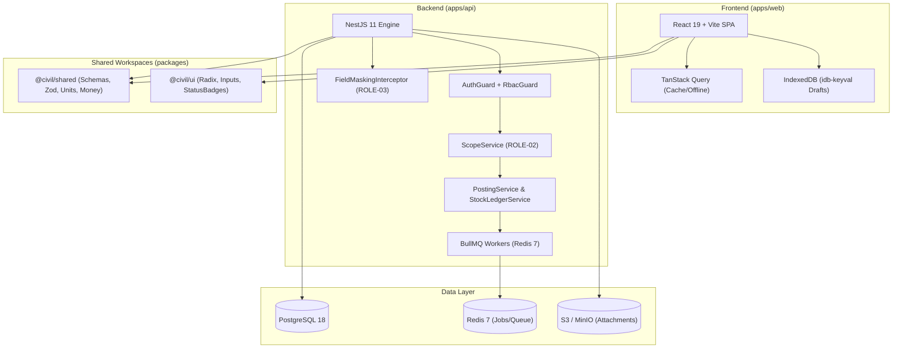
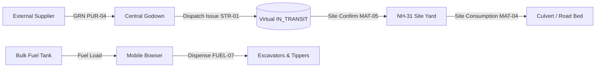
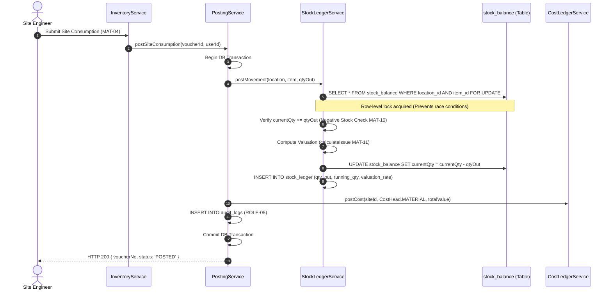
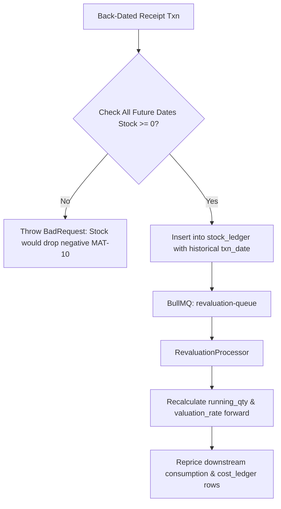
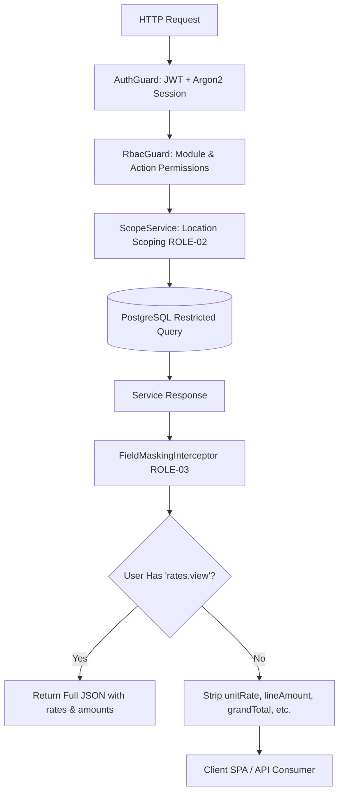

# Works Contract Management ERP — Architecture Specification

This document details the system design, core ledger engines, valuation mechanisms, security scoping, and transaction lifecycles for the Indian Works Contract ERP.

---

## 1. High-Level Monorepo Architecture

The system is structured as a Turborepo monorepo with strict TypeScript typing across frontend, backend, and shared libraries.

---

## 2. Location-Centric Multi-Entity Topology (Section 4.1)

Every physical or logical site where stock can sit or cost can occur is represented in `locations`:

- `CENTRAL_STORE`: Central Godown / Base Depot
- `SITE_STORE`: Project Site Camp Yard
- `PLANT_STORE`: Asphalt Hot Mix / Concrete Batching / Stone Crusher Raw Yard
- `FUEL_TANK`: Stationary Bulk Diesel Storage Tank
- `FUEL_BOWSER`: Mobile Bowser Tanker (`current_site_id` tracks active location)
- `IN_TRANSIT`: Virtual staging point for goods on the road

---

## 3. The Core Ledger Engine (Heart of the System)

### 3.1 Append-Only Ledgers

1. **`stock_ledger`**: Append-only movement log (`qty_in`, `qty_out`, `rate`, `value_in`, `value_out`, `running_qty`, `running_value`, `valuation_rate`).
2. **`stock_balance`**: Materialized balance per `(location_id, item_id)` protected with `SELECT ... FOR UPDATE` row-level locks.
3. **`cost_ledger`**: Append-only recording of site costs under standard heads (`MATERIAL`, `LABOUR`, `SUBCONTRACT`, `VEHICLE_FUEL`, `VEHICLE_HIRE`, `MISC_EXPENSE`, `OVERHEAD`).
4. **`party_ledger`**: General sub-ledger for suppliers, clients, subcontractors, and worker advances.

### 3.2 Atomic Posting Sequence

---

## 4. Weighted Average Valuation & Back-Dating (MAT-11 / MAT-14)

### Weighted Average Receipt Formula
$$\text{New Qty} = \text{Current Qty} + \text{Received Qty}$$
$$\text{New Value} = \text{Current Value} + (\text{Received Qty} \times \text{Received Rate})$$
$$\text{New Valuation Rate} = \frac{\text{New Value}}{\text{New Qty}}$$

### Back-Dating Revaluation Cycle
When a receipt or adjustment is entered with a historical `txn_date`:
1. **Synchronous Validation**: Verifies that inserting the entry will not cause stock to drop below zero at any point between `txn_date` and current date.
2. **Asynchronous Job**: Enqueues a job in BullMQ (`revaluation-queue`). The processor steps through all subsequent ledger entries in chronological order, updates running balances, recomputes average rates, and updates downstream consumption entries in `cost_ledger`.

---

## 5. Security: Scoping, RBAC, and Field Masking

- **ScopeService (ROLE-02)**: Request-scoped provider injected into queries. Site engineers can only access data belonging to their assigned site IDs and location IDs.
- **FieldMaskingInterceptor (ROLE-03)**: Automatically strips sensitive commercial values (`unitRate`, `lineAmount`, `grandTotal`, `valuationRate`, `debit`, `credit`) before response serialization if the user lacks commercial permissions.
